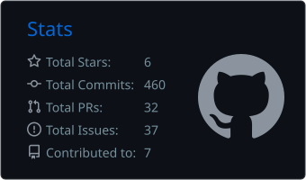
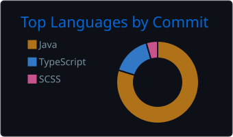
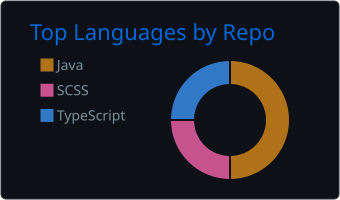
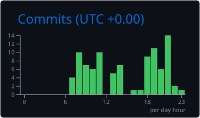

### Hi there! 🫡

I'm RaffSStein, a backend software engineer based in Italy!

I love turning ideas and passions into code, so that's what you'll be finding in here!

Outside of code and other boring stuff, you'll find me playing Tekken and some other fighting games.
I also enjoy playing guitar and studying tech stuff.

> "Building the future and keeping the past alive are one and the same thing."
> 
> — Solid Snake, *Metal Gear Solid 2*
> 

### 🌐 Socials

### 🖥️ Tech stack

### 📊 GitHub Stats

<table>
  <tr>
    <td width="50%"></td>
    <td width="50%"></td>
  </tr>
  <tr>
    <td width="50%"></td>
    <td width="50%"></td>
  </tr>
</table>
